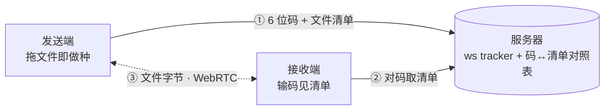

# droprelay

内网 P2P 文件直传：拖文件、对 6 位码、拿走。服务器只当信令员，文件字节走浏览器之间的 WebRTC 数据通道，不经手文件本体。



同一内核还带一个目录做种站（`shareweb/`，Caddy file_server browse 观感）：站点根的文件 URL 本身就是 webseed——路由器供第一份，之后下载过的人互为 peer，接力分摊带宽。

## 特性

- **两次操作**：发送端拖文件进页面即逐文件做种并生成 6 位传送码（可持续追加，每文件一个独立 torrent 池）；接收端输码即见清单，点行拿单个、点「下载」拿剩余全部。无需注册、无需安装。
- **服务器零落盘**：ws tracker（offer/answer 信令）+ 一张码↔清单对照表，日志仅内存环形缓冲；字节全走 P2P（能打洞直连，打不洞走路由器上的自托管 TURN 中继，仍不出内网）。
- **整夹上传/下载**：拖文件夹入页递归做种，接收端按原目录分组展示、按目录结构落盘；无目录能力的浏览器自动退为流式 zip。
- **边收边写**：`file.stream()` 直落文件句柄或 OPFS 中转，整份不进内存；手机可用。
- **老内核兼容**：esbuild 打包 target es2018，微信 X5 / 旧 iOS / 旧 Android WebView 可用；微信/QQ 内置浏览器自动引导跳系统浏览器。
- **传输内核** [WebTorrent](https://webtorrent.io)（浏览器间 WebRTC），服务端信令为 Go 标准库单二进制（`go:embed` 嵌入前端）。

## 构建

依赖：Go ≥ 1.26、Node（esbuild 打包前端）。前端改动后重新 `make build`（嵌入二进制）。

```sh
make build   # → droprelay-linux-arm64 + droprelay-stun-linux-arm64（CGO_ENABLED=0 静态）
make stun    # 本机架构的 stun 二进制
go test ./...
```

## 运行

```sh
# drop 应用 + tracker（前端已嵌入；同目录存在 shareweb/ 时优先读盘，便于调试）
droprelay -addr 127.0.0.1:8791
```

房间闲置 2h / 存活 6h 自动回收；对码探测、建房均有限速；`GET /api/health` 探活，`GET /api/log` 看内存日志（建议反代对公网封掉）。

## shareweb：目录做种站

`shareweb/` 是同一内核的第二个前端：Caddy file_server browse 观感的目录列表，把一个静态目录变成「路由器供第一份，下载过的人互为 peer」的做种站。与 drop 应用同一二进制、同一端口，靠主机名分流——`-webroot` 启用后，`Host` 以 `share.` 开头的请求走做种站，其余照旧走 drop 应用（反代上把 `share.example.com` 与主域指向同一监听即可）。

```sh
# ① 生成清单：逐文件一个 .torrent（增量：path+size+mtime 未变直接复用，不重哈希）
droprelay -manifest /srv/share -out /srv/share/manifest.json

# ② 带根目录运行（建议反代 + TLS）
droprelay -addr 127.0.0.1:8791 -webroot /srv/share -mfile /srv/share/manifest.json
```

- **站点根即 webseed**：URL 指向存在的文件就带访问日志直出——这条 URL 就是 webseed 本身，页面里的下载与任何 HTTP 客户端直访是同一条；目录路径渲染做种页，`?zip=1` 流式打包整个目录（Store 不压缩，服务器零临时文件）。
- **清单与站点解耦**：种子默认不烙 announce 和 url-list，由前端按当前站点根动态给出——换域名、换基准不废清单，只需重跑一遍 `-manifest`（未变文件不重新哈希）。
- **页面交互**：左键文件行 = P2P 下载（进度画在 sizebar 上）；Ctrl / 中键 / 长按 = 直链；JS 失效时整页退化为纯直链列表，等同旧 Caddy。
- **单一下载源**：本机整文件 → 其他 peer（tracker 说有人在种）→ 站点顺序 HTTP → 浏览器自带下载，一次只走一条路，绝不 P2P 与 HTTP Range 同时打机械盘。
- **按需入池**：空手访客不向 tracker 报任何 leech，种子只在真的点下载时才 announce；share 主机上 `/api/*` 一律 404（单放 `/api/health`，前端靠它拿 P2P 等待窗）。

## STUN/TURN（跨 NAT 部署才需要）

默认 ICE 服务器为空 = 只用 host 候选，同一网段内直连即可用。要跨 NAT（AP 隔离、对称 NAT）就自托管 `cmd/stun`（STUN Binding + TURN Allocate，pion/turn）：

**服务端：**

```sh
droprelay-stun -addr 0.0.0.0:3478 \
  -user u -pass p -realm example.com \
  -relay <对 peer 可达的本机 IPv4>   # 多宿主机器建议显式指定
droprelay-stun -probe 127.0.0.1:3478  # 自测 Binding
```

防火墙放行 UDP 3478（STUN/TURN）与 49152–49311（中继端口段），参考 `scripts/openwrt-stun-fw.sh`。

**前端（构建期注入）：**

```sh
ICE_SERVERS='[{"urls":["stun:stun.example.com:3478"]},{"urls":["turn:stun.example.com:3478"],"username":"u","credential":"p"}]' make build
```

或写入 `scripts/local.env`（git 忽略，模板见 `scripts/local.env.example`），`make build` 自动读取。两侧用户名/密码/realm 必须配对。

## 部署

单二进制扔进任意 Linux 即可。仓库自带的小工具：

```sh
HOST=user@host make deploy   # md5 相同不重传不重启；目标机需 ssh 免密
make stun-fw                 # 目标为 OpenWrt 时一键放行防火墙端口
```

生产建议前置反代做 TLS；静态资源已带显式 `Cache-Control`（HTML/JS/CSS no-cache、字体 immutable）。

## 设计取舍

- **码即凭据**：无口令，安全性靠 6 位去混淆码不可猜性（31⁶ ≈ 8.9 亿）+ 探测/建房限速 + 房间数上限；建房返回的 room token 恒时比较，用于追加/移除文件。
- **多宿主回包**：通配 UDP 监听开 `IP_PKTINFO` 按请求目的地址回包——否则内核按出接口选源，浏览器按对端过滤直接丢（`cmd/stun/pktinfo.go`）。
- **不做仓库**：发送端本机缓存 24h 无下载活动即清，接收端存储一次性；服务器不写任何磁盘文件（`-manifest` 显式生成除外）。

## License

[GPL-3.0](LICENSE)
